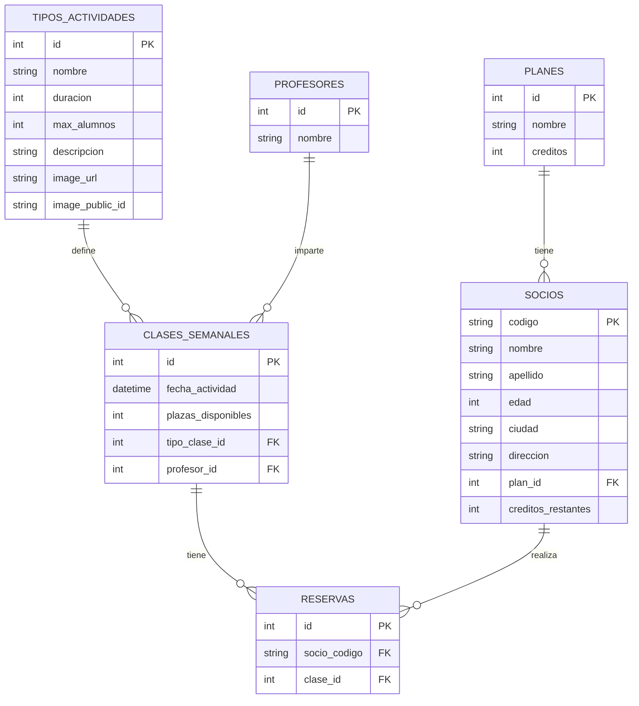

# 🏋️ PulseGym — Sistema de Gestión y Administración (GymGes)

Plataforma integral para la gestión operativa y administración de un estudio deportivo boutique (**PulseGym**). El sistema comprende un panel de administración para la gestión de clases, socios, tarifas, profesores, reservas y subida de imágenes, complementado con la arquitectura cliente para el portal del centro.

---

## 🏛️ Arquitectura del Proyecto

El proyecto está diseñado bajo una arquitectura desacoplada por capas tanto en frontend como en backend:
* **Backend:** FastAPI con arquitectura modular (*Routes ➔ Controllers ➔ Services ➔ Models/Schemas*), persistencia relacional con SQLAlchemy/SQLite y migraciones con Alembic.
* **Frontend:** JavaScript Vanilla modular (ES Modules) y CSS nativo basado en variables de diseño (`custom properties`), sin frameworks pesados ni dependencias externas.

```plaintext
GymGes-Project/
│
├── GymGes-backend/                  # API REST construida con FastAPI y SQLAlchemy
│   ├── controller/                  # Controladores de orquestación y lógica
│   │   ├── activity_type_controller.py
│   │   ├── booking_controller.py
│   │   ├── member_controller.py
│   │   ├── plan_controller.py
│   │   ├── teacher_controller.py
│   │   └── weekly_class_controller.py
│   ├── core/                        # Configuraciones centrales del sistema
│   │   ├── cloudinary_config.py     # Inicialización del SDK de Cloudinary
│   │   ├── config.py                # Carga de variables de entorno (Settings)
│   │   └── database.py              # Sesión de motor SQLAlchemy y Base declarativa
│   ├── models/                      # Modelos de datos del ORM (SQLAlchemy)
│   │   ├── activity_type_model.py
│   │   ├── booking_model.py
│   │   ├── member_model.py
│   │   ├── plan_model.py
│   │   ├── teacher_model.py
│   │   └── weekly_class_model.py
│   ├── routes/                      # Definición de endpoints y APIRouters
│   │   ├── activity_type_routes.py
│   │   ├── booking_routes.py
│   │   ├── member_routes.py
│   │   ├── plan_routes.py
│   │   ├── teacher_routes.py
│   │   └── weekly_class_routes.py
│   ├── schema/                      # Validación y serialización de datos (Pydantic)
│   │   ├── activity_type_schema.py
│   │   ├── booking_schema.py
│   │   ├── member_schema.py
│   │   ├── plan_schema.py
│   │   ├── teacher_schema.py
│   │   └── weekly_class_schema.py
│   ├── service/                     # Capa de servicios auxiliares y negocio
│   │   └── cloudinary_service.py    # Subida y transformación de imágenes
│   ├── alembic.ini                  # Configuración de migraciones de base de datos
│   ├── main.py                      # Punto de entrada de la aplicación FastAPI
│   └── requirements.txt             # Dependencias del backend de Python
│
└── GymGes-Frontend/                 # Interfaz de usuario y panel de administración
    ├── assets/                      # Recursos gráficos estáticos y favicons
    ├── pages/                       # Vistas HTML secundarias
    │   ├── admin/                   # Módulos del panel de administración
    │   │   ├── activities-admin.html
    │   │   ├── bookings-admin.html
    │   │   ├── members-admin.html
    │   │   ├── plans-admin.html
    │   │   ├── schedules-admin.html
    │   │   └── teachers-admin.html
    │   ├── calendar.html            # Cartelera interactiva de horarios
    │   └── user.html                # Espacio del socio
    ├── src/
    │   ├── css/                     # Hojas de estilo modulares
    │   │   ├── components/          # Componentes desacoplados (tablas, modales, etc.)
    │   │   ├── layout/              # Estructura base (sidebar, header, grid)
    │   │   ├── styles.css           # Punto central de importación y reset
    │   │   └── variables.css        # Tokens de diseño institucional
    │   └── js/                      # Lógica de cliente en ES Modules
    │       ├── admin/               # Controladores de administración (members.js)
    │       ├── api/                 # Cliente de red Axios centralizado
    │       ├── client/              # Controladores públicos (calendar.js, user.js)
    │       └── services/            # Capa adaptadora hacia la API REST
    └── index.html                   # Página principal
```

---

## ⚙️ Guía de Variables de Entorno

La API de FastAPI y la persistencia de datos se parametrizan mediante un archivo `.env` ubicado en la raíz de `GymGes-backend/`.

### Configuración del archivo `.env`

```env
# ==============================================================================
# Application Settings
# ==============================================================================
APP_TITLE="GymGes API"
APP_VERSION="1.0.0"
APP_DESCRIPTION="REST API for managing a gym: activity types, weekly classes, teachers, members and bookings, built with FastAPI, SQLAlchemy and SQLite."

# ==============================================================================
# Database Settings
# ==============================================================================
DATABASE_NAME="gymges.sqlite3"
DATABASE_URL="sqlite:///./gymges.sqlite3"

# ==============================================================================
# Media Storage (Cloudinary)
# ==============================================================================
CLOUDINARY_URL="cloudinary://<API_KEY>:<API_SECRET>@<CLOUD_NAME>"
```

### Descripción de Parámetros

| Variable | Tipo | Requerida | Propósito |
| :--- | :--- | :---: | :--- |
| `APP_TITLE` | `string` | No (valor por defecto) | Nombre de la API en la documentación OpenAPI y Swagger UI. |
| `APP_VERSION` | `string` | No (valor por defecto) | Versión de la API. |
| `APP_DESCRIPTION` | `string` | No | Descripción técnica visible en la documentación interactiva. |
| `DATABASE_NAME` | `string` | No (valor por defecto) | Nombre del archivo de base de datos SQLite local. |
| `DATABASE_URL` | `string` | No (valor por defecto) | Cadena de conexión utilizada por el motor SQLAlchemy. |
| `CLOUDINARY_URL` | `string` | Para imágenes | URI autenticada para subir y almacenar fotografías en Cloudinary. |
| `GYM_TIMEZONE` | `string` | No (por defecto, `Europe/Madrid`) | Zona horaria utilizada para comprobar las fechas y las reglas de cancelación. |

---

## 🗄️ Esquema Entidad-Relación (BBDD)

La base de datos relacional está normalizada en 3NF para garantizar la integridad referencial y la coherencia del balance de créditos entre clases y socios.



### Reglas de Negocio Vinculadas al Modelo
* **Identificador de Socio:** Clave primaria `codigo` normalizada a 9 caracteres (DNI/NIE).
* **Consumo de Créditos:** La creación de una reserva resta 1 crédito en la ficha del socio y decrementa las plazas disponibles de la clase.
* **Cancelación de Reserva:** No se puede cancelar durante las dos horas previas al comienzo de la clase. Si la cancelación está permitida y la sesión es futura, se devuelve el crédito y se libera la plaza en el horario semanal.

---

## 📡 Documentación de la API REST

Los endpoints siguen convenciones RESTful bajo FastAPI. Los modelos del backend se definen en inglés y son consumidos por el frontend a través de la capa `services/` con transformación transparente.

### 1. Socios (`/members/`)

| Método | Ruta | Descripción | Parámetros / Cuerpo | Código de Respuesta |
| :--- | :--- | :--- | :--- | :---: |
| `GET` | `/members/` | Obtiene el listado paginado de socios | Query opcional: `skip`, `limit` (máximo 1000 por petición) | `200 OK` |
| `GET` | `/members/{code}` | Consulta la ficha de un socio por su DNI | `code`: string (en ruta) | `200 OK` |
| `POST` | `/members/` | Da de alta un nuevo socio | JSON con datos del socio | `201 Created` |
| `PUT` | `/members/{code}` | Modifica los datos de un socio existente | JSON con datos actualizados | `200 OK` |
| `DELETE` | `/members/{code}` | Elimina el registro del socio del sistema | `code`: string (en ruta) | `204 No Content` |

### 2. Clases Semanales (`/weekly-classes/`)

| Método | Ruta | Descripción | Parámetros / Cuerpo | Código de Respuesta |
| :--- | :--- | :--- | :--- | :---: |
| `GET` | `/weekly-classes/` | Cartelera de clases programadas y aforo | Query opcional: `skip`, `limit` (máximo 1000 por petición) | `200 OK` |
| `POST` | `/weekly-classes/` | Programa una nueva sesión en el horario | JSON con datos de la sesión | `201 Created` |
| `DELETE` | `/weekly-classes/{id}` | Cancela administrativamente una clase | `id`: integer (en ruta) | `204 No Content` |

### 3. Reservas (`/booking/`)

| Método | Ruta | Descripción | Parámetros / Cuerpo | Código de Respuesta |
| :--- | :--- | :--- | :--- | :---: |
| `GET` | `/booking/` | Registro de reservas del centro | Query opcional: `skip`, `limit` (máximo 1000 por petición) | `200 OK` |
| `GET` | `/booking/member/{member_code}` | Obtiene las reservas de un socio | `member_code`: string (en ruta) | `200 OK` |
| `POST` | `/booking/` | Reserva plaza y descuenta 1 crédito | `{ "member_code": "...", "class_id": 0 }` | `201 Created` |
| `DELETE` | `/booking/{booking_id}` | Elimina una reserva; la devolución depende de la fecha de la sesión y del límite de cancelación | `booking_id`: integer (en ruta) | `204 No Content` |

### 4. Catálogos Maestros

| Método | Ruta | Descripción |
| :--- | :--- | :--- |
| `GET` | `/activity-types/` | Disciplinas ofertadas (Pilates, Yoga, Crossfit), duración y capacidad. |
| `GET` | `/teachers/` | Relación de profesores e instructores disponibles. |
| `GET` | `/plans/` | Planes de suscripción vigentes y créditos asociados. |

---

## 📋 Tablero de Estado de Entregables — Panel de Administración (Sprint Milestones)

| Módulo | Entregable / Funcionalidad | Estado | Descripción técnica |
| :--- | :--- | :---: | :--- |
| **Arquitectura** | Sistema de diseño y estilos CSS modular desde cero | ✅ Completado | Arquitectura BEM y variables CSS nativas (`variables.css`), estructurada por componentes (`components/`) y layout sin dependencias de frameworks externos. |
| **Arquitectura** | Capa adaptadora de servicios (Data Mapper) | ✅ Completado | Transformación bidireccional transparente entre esquemas de API en inglés y controladores frontend (`memberService.js`, `planService.js`, etc.). |
| **Gestión Multimedia** | Integración con CDN Cloudinary | ✅ Completado | Servicio desacoplado (`cloudinary_service.py` y `cloudinary_config.py`) para subida, almacenamiento y optimización de fotografías de actividades. |
| **Gestión de Socios** | Directorio y operaciones CRUD de miembros | ✅ Implementado | Listado reactivo, formularios modales para alta/edición, validación del código de socio y asignación inicial de créditos según el plan al dar de alta. |
| **Gestión de Socios** | Barra de búsqueda y filtrado por código | ✅ Completado | Componente reutilizable `.table-toolbar` integrado en la tabla con consulta por endpoint, reseteo de lista y feedback de estado accesible. |
| **Gestión de Socios** | Modal de baja y confirmación destructiva | ✅ Completado | Diálogo accesible de confirmación para eliminación de socios con advertencia de liberación de plazas y cancelación de reservas. |
| **Gestión de Planes** | Catálogo de tarifas y balance de créditos | ✅ Completado | Lectura y vinculación de planes activos para parametrizar altas y consumos de créditos por sesión. |
| **Actividades Deportivas** | Catálogo y configuración de disciplinas | ✅ Completado | CRUD de actividades con definición de duración, aforo máximo y vinculación de fotografías optimizadas en Cloudinary. |
| **Horarios y Sesiones** | Programación del cuadrante semanal | ✅ Completado | Creación, consulta y anulación de sesiones grupales asociadas a disciplina, monitor, fecha y plazas disponibles. |
| **Gestión Docente** | Directorio del profesorado e instructores | ✅ Completado | Mantenimiento de perfiles de instructores vinculados a la impartición de clases semanales. |
| **Control de Reservas** | Monitor global de asistencia del centro | ✅ Completado | Auditoría administrativa de reservas activas, control de aforos y anulación manual de plazas. |
| **Entrega / Release** | Consolidación y entrega en rama principal (`main`) | 🚀 Listo para entrega | Código verificado, libre de dependencias superfluas y documentado para la presentación técnica. |

---

## 🚀 Guía de Puesta en Marcha Local

### Prerrequisitos
* **Python 3.10 o superior** con gestor `pip` y entorno virtual activado.
* Servidor web para estáticos (extensión **Live Server** de VS Code o `npx serve`).

Los comandos siguientes presuponen que `GymGes-Frontend` y `GymGes-backend` están en carpetas hermanas dentro de `GymGes-Project/`. Ejecútalos desde esa carpeta raíz.

### 1. Servidor Backend (FastAPI)
```cmd
# Acceder a la carpeta del backend
cd GymGes-backend

# Crear y activar el entorno virtual (Windows CMD)
python -m venv .venv
.venv\Scripts\activate.bat

# Instalar las dependencias del proyecto
pip install -r requirements.txt

# Opcional: ejecutar las migraciones manualmente; main.py también las aplica al arrancar
alembic upgrade head

# Iniciar la API con recarga en vivo
uvicorn main:app --reload --port 8000
```
*Documentación interactiva Swagger UI disponible en:* `http://127.0.0.1:8000/docs`

Al arrancar, `main.py` aplica las migraciones y carga los datos de demostración solo si la base de datos está vacía.

### 2. Cliente Frontend
```cmd
# Acceder a la carpeta del frontend
cd GymGes-Frontend

# Iniciar servidor estático de desarrollo
npx serve .
```
*Portal accesible en:* `http://localhost:3000` (o el puerto configurado por Live Server, habitualmente `http://127.0.0.1:5500`).

La URL de la API se configura en `src/js/config/endpointsConfig.js`. Actualmente apunta al backend desplegado en Render; para usar el backend local, configura `API_BASE_URL` como `http://127.0.0.1:8000/`.
